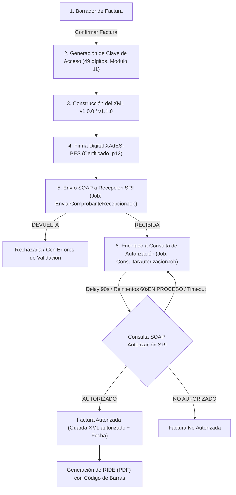

# Facturación Electrónica SRI (Ecuador)

<p align="center">
  
  
  
  
  
  
  
  
  
  
  
  
</p>

<p align="center">
  
</p>

---

Sistema web **multiempresa** desarrollado con **Laravel 12** y **Livewire 3** para la gestión, emisión, firma digital criptográfica (XAdES-BES) y autorización de comprobantes electrónicos offline conforme a la ficha técnica oficial del **Servicio de Rentas Internas (SRI) del Ecuador**.

---

## Tabla de Contenidos

- [Características Principales](#características-principales)
- [Arquitectura y Ciclo de Vida del Comprobante](#arquitectura-y-ciclo-de-vida-del-comprobante)
- [Herramientas y Stack Tecnológico](#herramientas-y-stack-tecnológico)
- [Requisitos del Sistema](#requisitos-del-sistema)
- [Guía de Instalación para Desarrollo Local](#guía-de-instalación-para-desarrollo-local)
- [Gestión de Certificados Digitales y OpenSSL Legacy](#gestión-de-certificados-digitales-y-openssl-legacy)
- [Usuarios y Datos de Demostración](#usuarios-y-datos-de-demostración)
- [Despliegue y Puesta a Punto en Producción](#despliegue-y-puesta-a-punto-en-producción)
- [Pruebas Automatizadas](#pruebas-automatizadas)
- [Estructura del Proyecto](#estructura-del-proyecto)
- [Licencia](#licencia)

---

## Características Principales

- **Multiempresa (Multi-tenant):** Aislamiento estricto de empresas, sucursales (establecimientos), puntos de emisión, secuencias numéricas y usuarios por roles.
- **Cumplimiento Ficha Técnica SRI:**
  - Generación de **Clave de Acceso de 49 dígitos** con algoritmo de verificación Módulo 11 y tipo de emisión normal (1).
  - Formato XML de facturas v1.0.0 / v1.1.0 con soporte para impuestos desagregados (IVA 0%, 5%, 8%, 15%, no objeto y exento).
  - Límite automático para venta a Consumidor Final (`9999999999999`).
- **Firma Electrónica Criptográfica:** Firma digital estándar **XAdES-BES** sobre archivos de firma en formato PKCS#12 (`.p12` / `.pfx`), con contraseñas cifradas en base de datos.
- **Procesamiento Asíncrono de Comprobantes:**
  - Envío SOAP al Web Service de Recepción del SRI mediante cola Redis (`sri`).
  - Monitoreo y reintentos programados mediante jobs asíncronos para consulta de autorización con retardo escalonado (90s inicial, 60s reintentos, hasta 24h).
- **Generación de RIDE y Descargas:**
  - Generación de representación impresa digital (RIDE) en PDF vía DomPDF con código de barras Code 128 de la clave de acceso.
  - Descarga segura de XML firmado original y autorizado por el SRI.
- **Control de Acceso basado en Roles (RBAC):** Roles preconfigurados con `spatie/laravel-permission`: `admin`, `contador` y `facturador`.

---

## Arquitectura y Ciclo de Vida del Comprobante

El ciclo de facturación se procesa garantizando integridad transaccional y resistencia a fallas de conectividad con los servidores del SRI:



---

## Herramientas y Stack Tecnológico

| Herramienta | Badge / Icono | Versión / Detalle | Propósito |
| :--- | :--- | :--- | :--- |
| **PHP** |  | `^8.2` | Lenguaje base del backend |
| **Laravel** |  | `12.x` | Framework web robusto y seguro |
| **Livewire & Volt** |  | `3.6+` / `1.7+` | Reactividad del frontend sin APIs intermedias |
| **Tailwind CSS** |  | `3.4+` | Sistema de estilos y diseño adaptable |
| **PostgreSQL** |  | `14+` | Base de datos relacional para producción |
| **SQLite** |  | `3.x` | Base de datos local y suite de tests (`:memory:`) |
| **Redis** |  | `6.x+` | Colas de alta concurrencia y caché |
| **Laravel Horizon** |  | `5.48+` | Dashboard y supervisión de colas Redis (`sri`, `default`) |
| **Vite** |  | `6.x` | Empaquetador de assets y HMR |
| **xmlseclibs** |  | `4.0` | Firma digital XMLDSig y XAdES-BES |
| **DomPDF** |  | `3.1` | Motor de renderizado de RIDE a PDF |
| **Barcode Generator** |  | `3.3` | Código de barras para clave de acceso en RIDE |

---

## Requisitos del Sistema

- **PHP 8.2** o superior.
- **Extensiones obligatorias de PHP:**
  - `ext-soap` (indispensable para comunicación Web Service SOAP con el SRI).
  - `ext-openssl` (firma criptográfica y cifrado de claves).
  - `ext-dom` y `ext-libxml` (manipulación y firma del XML).
  - `ext-bcmath` (cálculos exactos de decimales e impuestos sin pérdida de precisión).
  - `ext-pdo_pgsql` (PostgreSQL) y `ext-pdo_sqlite` (SQLite).
- **Composer 2.x**.
- **Node.js 18+** y **npm**.
- **Redis Server** (para colas de background en producción o desarrollo).

---

## Guía de Instalación para Desarrollo Local

### 1. Clonar el repositorio
```bash
git clone <url-del-repositorio> sri-facturacion
cd sri-facturacion
```

### 2. Instalar dependencias
```bash
composer install
npm ci
```

### 3. Configurar el archivo de entorno
```bash
cp .env.example .env
php artisan key:generate
```

Asegúrate de configurar tu conexión de base de datos en `.env`. Para desarrollo rápido con SQLite:
```env
DB_CONNECTION=sqlite
# Asegúrate de crear el archivo database/database.sqlite si no existe:
# touch database/database.sqlite
```

O si utilizas PostgreSQL:
```env
DB_CONNECTION=pgsql
DB_HOST=127.0.0.1
DB_PORT=5432
DB_DATABASE=sri_facturacion
DB_USERNAME=postgres
DB_PASSWORD=secret
```

### 4. Ejecutar migraciones y seeders
El seeder crea automáticamente los roles de seguridad, los catálogos de tarifas IVA oficiales del SRI y una empresa y usuarios de demostración:
```bash
php artisan migrate --seed
```

### 5. Iniciar el entorno de desarrollo
El proyecto incluye un script en `composer.json` que utiliza `concurrently` para orquestar todos los servicios requeridos (servidor web, worker de colas con OpenSSL legacy, logs de pail y servidor Vite) en una sola terminal:

```bash
composer run dev
```

Este comando levanta:
1. **Servidor HTTP:** `php artisan serve` (con `OPENSSL_CONF` activado).
2. **Worker de Colas:** `php artisan queue:listen --queue=sri,default` (con `OPENSSL_CONF` activado).
3. **Visor de Logs en tiempo real:** `php artisan pail`.
4. **Vite Development Server:** `npm run dev`.

---

## Gestión de Certificados Digitales y OpenSSL Legacy

### ¿Por qué se requiere `openssl-legacy.cnf`?
En Ecuador, muchas entidades de certificación autorizadas (Banco Central del Ecuador, Security Data, ANFAC, Consejo de la Judicatura) emiten archivos de firma electrónica `.p12` / `.pfx` empaquetados con algoritmos de derivación de claves heredados (como RC2-40-CBC o 3DES). 

A partir de **OpenSSL 3.x** (por defecto en Ubuntu 22.04+, macOS Homebrew y PHP 8.2+), estos algoritmos están desactivados por defecto en el proveedor estándar. Si no se activan, la función `openssl_pkcs12_read()` fallará al intentar leer el certificado.

El repositorio incluye el archivo [openssl-legacy.cnf](openssl-legacy.cnf):
```ini
openssl_conf = openssl_init
[openssl_init]
providers = provider_sect
[provider_sect]
default = default_sect
legacy = legacy_sect
[default_sect]
activate = 1
[legacy_sect]
activate = 1
```

> **IMPORTANTE:** Toda ejecución de PHP que procese firmas (tanto `php artisan serve`, como los workers de cola y Horizon) debe ejecutar con la variable de entorno:
> ```bash
> OPENSSL_CONF="$PWD/openssl-legacy.cnf" php artisan horizon
> ```

---

## Usuarios y Datos de Demostración

Al ejecutar `php artisan db:seed`, se genera la siguiente estructura:

### Empresa Demo:
- **RUC:** `1792146739001`
- **Razón Social:** `EMPRESA DE PRUEBA S.A.`
- **Establecimiento:** `001` | **Punto de Emisión:** `001`
- **Ambiente:** `1` (Pruebas / Certificación)

### Credenciales de Usuario:
La contraseña por defecto para todas las cuentas semilla es `password`:

| Usuario | Correo Electrónico | Contraseña | Rol Asignado | Permisos |
| :--- | :--- | :--- | :--- | :--- |
| **Admin Empresa** | `admin@example.com` | `password` | `admin` | Configuración de empresa, certificados, usuarios y facturación completa |
| **Carlos Contador** | `contador@example.com` | `password` | `contador` | Consulta de facturas, reportes, descarga de RIDE y XML |
| **Ana Facturadora** | `facturador@example.com` | `password` | `facturador` | Creación y emisión de facturas electrónicas |

---

## Ambientes del SRI (Ecuador)

El sistema soporta el cambio de ambiente por empresa en `config/sri.php`:

| Parámetro | Ambiente 1: Pruebas (Celcer) | Ambiente 2: Producción (Cel) |
| :--- | :--- | :--- |
| **Recepción SOAP** | `https://celcer.sri.gob.ec/comprobantes-electronicos-ws/RecepcionComprobantesOffline?wsdl` | `https://cel.sri.gob.ec/comprobantes-electronicos-ws/RecepcionComprobantesOffline?wsdl` |
| **Autorización SOAP** | `https://celcer.sri.gob.ec/comprobantes-electronicos-ws/AutorizacionComprobantesOffline?wsdl` | `https://cel.sri.gob.ec/comprobantes-electronicos-ws/AutorizacionComprobantesOffline?wsdl` |
| **Consulta SOAP** | `https://celcer.sri.gob.ec/comprobantes-electronicos-ws/ConsultaComprobante?wsdl` | `https://cel.sri.gob.ec/comprobantes-electronicos-ws/ConsultaComprobante?wsdl` |

Variables de retardo y tiempos de espera configurables en `.env`:
```env
SRI_SOAP_TIMEOUT=30
SRI_AUTORIZACION_DELAY_INICIAL=90
SRI_AUTORIZACION_DELAY_REINTENTO=60
SRI_AUTORIZACION_MAX_HORAS=24
```

---

## Despliegue y Puesta a Punto en Producción

### 1. Variables de Entorno de Producción
En el servidor de producción, define en tu archivo `.env`:
```env
APP_ENV=production
APP_DEBUG=false
APP_URL=https://facturacion.tuempresa.com

DB_CONNECTION=pgsql
DB_HOST=127.0.0.1
DB_PORT=5432
DB_DATABASE=facturacion_prod
DB_USERNAME=usuario_prod
DB_PASSWORD=password_seguro

QUEUE_CONNECTION=redis
CACHE_STORE=redis
SESSION_DRIVER=redis

REDIS_CLIENT=phpredis
REDIS_HOST=127.0.0.1
REDIS_PORT=6379
```

### 2. Optimización de Caché y Assets
Ejecuta la optimización de Laravel:
```bash
composer install --no-dev --optimize-autoloader
php artisan config:cache
php artisan route:cache
php artisan view:cache
npm ci
npm run build
```

### 3. Configuración de Supervisor para Laravel Horizon
Para que las facturas se firmen y autoricen en segundo plano sin interrupciones, configura Supervisor (`/etc/supervisor/conf.d/sri-horizon.conf`):

```ini
[program:sri-horizon]
process_name=%(program_name)s
command=php /var/www/sri-facturacion/artisan horizon
autostart=true
autorestart=true
user=www-data
redirect_stderr=true
stdout_logfile=/var/log/supervisor/sri-horizon.log
stopwaitsecs=3600
environment=OPENSSL_CONF="/var/www/sri-facturacion/openssl-legacy.cnf"
```

> **NOTA:** Observa la línea `environment=OPENSSL_CONF="..."`. Es crítica para permitir a los workers de Horizon cargar las firmas digitales sin fallas criptográficas.

Recargar Supervisor:
```bash
sudo supervisorctl reread
sudo supervisorctl update
sudo supervisorctl start sri-horizon
```

### 4. Configurar el Programador de Tareas (Cron)
Agrega al crontab del usuario del servidor web (`crontab -e -u www-data`):
```cron
* * * * * cd /var/www/sri-facturacion && php artisan schedule:run >> /dev/null 2>&1
```

### 5. Pasos para el Pase a Producción ante el SRI
1. **Emisión en Pruebas:** Emite facturas de prueba hacia el ambiente 1 y confirma que obtienen estado `AUTORIZADO` en el portal [SRI en Línea (Pruebas)](https://srienlinea.sri.gob.ec).
2. **Solicitud de Producción:** Solicita la autorización para emisión electrónica en producción desde el portal SRI con el RUC de la empresa.
3. **Cambio de Ambiente:** En la interfaz de configuración de la empresa en la aplicación, cambia el selector de ambiente de **Pruebas (1)** a **Producción (2)**.
4. **Verificación de Secuenciales:** Verifica que el establecimiento (`001`) y punto de emisión (`001`) coincidan con los registrados en el RUC del emisor.

---

## Pruebas Automatizadas

El proyecto cuenta con una cobertura de pruebas exhaustiva para validación de XML, cálculos de tarifas, firma criptográfica XAdES-BES, control de rutas, accesibilidad y ciclo de vida de jobs:

```bash
# Ejecutar todas las pruebas
composer run test

# O directamente con artisan
php artisan test
```

Resultado de la suite:
```text
Tests:    401 passed (1724 assertions)
Duration: ~12s
```

---

## Estructura Principal del Proyecto

```text
sri-facturacion/
├── app/
│   ├── Actions/
│   │   ├── Facturas/         # Lógica de guardado y cálculo de borradores
│   │   └── Sri/              # Confirmación, firma y despacho de facturas
│   ├── Http/Controllers/     # Controladores para descarga de RIDE y XML
│   ├── Jobs/                 # Jobs asíncronos (Recepción y Autorización SOAP)
│   ├── Livewire/             # Componentes Livewire 3 (Facturas, Empresas, etc.)
│   ├── Models/               # Modelos Eloquent (Empresa, Factura, TarifaIva, etc.)
│   └── Services/Sri/         # Servicios centrales SRI:
│       ├── ClaveAccesoService.php     # Generación de clave de acceso y Módulo 11
│       ├── FacturaXmlBuilder.php      # Construcción del XML v1.0.0 / v1.1.0
│       ├── XadesSigner.php            # Firma electrónica XAdES-BES
│       ├── SriRecepcionClient.php     # Cliente SOAP para recepción
│       ├── SriAutorizacionClient.php  # Cliente SOAP para autorización
│       └── RideGenerator.php          # Renderizado de PDF con código de barras
├── config/
│   ├── horizon.php           # Configuración de colas Redis (sri, default)
│   └── sri.php               # Endpoints WSDL, timeouts y retrasos de autorización
├── database/
│   ├── migrations/           # Esquema de tablas relacionales
│   └── seeders/              # Datos base (Roles, Tarifas IVA, Empresa demo)
├── openssl-legacy.cnf        # Configuración de proveedores legacy para OpenSSL 3.x
└── tests/
    ├── Feature/              # Pruebas de integración, Livewire y endpoints
    └── Unit/                 # Pruebas unitarias de cálculo, XML y firma
```

---

## Licencia

Este proyecto se distribuye bajo la licencia **MIT**. Consulta el archivo `LICENSE` para más información.
